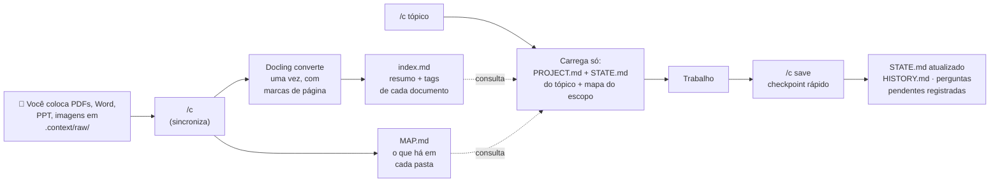

<a name="readme-top"></a>

<div align="center">

# 🧠 context-manager

### Memória de projeto para o Claude Code: ele lembra onde você parou e gasta poucos tokens

Criado por **Pedro Alexandre Piassi Silva** · [](https://www.linkedin.com/in/pedro-piassi6/)


[Começo rápido](#-começo-rápido) · [Como funciona](#-como-funciona) · [O que é criado](#-o-que-é-criado) · [Detalhes técnicos](#-detalhes-técnicos) · [FAQ](#-faq)

</div>

---

## ⚡ Em 30 segundos

| Sem a skill | Com a skill |
|---|---|
| Cada sessão começa do zero e você explica tudo de novo | `/c <tópico>` retoma de onde parou, com plano e pendências |
| O Claude lê PDFs e planilhas inteiros e gasta milhares de tokens | Cada documento é convertido **uma vez** em Markdown e lido **por página** |
| Assuntos diferentes se misturam na mesma memória | Cada tópico tem sua memória; a memória comum fica no `PROJECT.md` e as regras, num arquivo só |
| Regras espalhadas e repetidas em vários arquivos | As regras do projeto vivem em **um** lugar: `.claude/CLAUDE.md` ou o `AGENTS.md`, se o projeto tiver um |
| O Claude "decide" padrões sozinho | Dúvidas viram **perguntas pendentes**; só o que você confirma vira regra |
| Trocar de computador perde o contexto | A memória vai pelo git; o outro computador continua dali |

---

## 🚀 Começo rápido

**1.** Extraia o zip e arraste a pasta `context-manager/` para dentro de `.claude/skills/` do seu projeto.

**2.** No Claude Code, dentro do projeto:

```
/context-manager
```

O Claude mostra o que vai criar e pede **uma** confirmação. Depois ele instala tudo, inclusive o Docling (uma vez por computador), e mostra no chat a lista completa de comandos.

**3.** Daí em diante, use o atalho:

```
/c
```

> [!TIP]
> No dia a dia você só precisa de três: **`/c`** (sincroniza tudo), **`/c <tópico>`** (retoma um assunto) e **`/c save`** (salva antes de parar). A lista completa aparece com `/c commands`.

> [!NOTE]
> Se `/context-manager` não aparecer logo depois de copiar a pasta, abra uma sessão nova do Claude Code.

<p align="right"><a href="#readme-top">↑ topo</a></p>

---

## 🔄 Como funciona



**Três ideias sustentam tudo:**

| | Ideia | Na prática |
|---|---|---|
| 💸 | **Carregar pouco, de propósito** | Retomar um tópico lê 1 ou 2 arquivos curtos, não o projeto inteiro. Documentos são lidos por página. Arquivos grandes, primeiro por amostra. |
| 🧩 | **Memória separada por assunto** | Um `STATE.md` por tópico (e por subtópico). A memória comum (propósito, fontes de dados, log de decisões) fica no `PROJECT.md`. |
| 📏 | **Regra num lugar, memória em outro** | As regras valem a partir de agora e ficam num único arquivo: `.claude/CLAUDE.md` (fora do bloco da skill) ou o `AGENTS.md` da raiz, que o `.claude/CLAUDE.md` importa com `@../AGENTS.md`. O `PROJECT.md` guarda **quando e por que** se decidiu. A skill **nunca escreve** no arquivo de regras: regras suas ou de terceiros nunca são sobrescritas. Regra que vale só para um tópico (por exemplo, "nesta fase, só desenho") fica no `STATE.md` dele. Hierarquia: arquivo de regras > tópico-pai > tópico; a regra mais estreita só refina a mais ampla, nunca contradiz. |
| 🔁 | **Um comando que reconcilia** | `/c` verifica e corrige a estrutura, aplica o que você editou à mão, detecta tópicos e documentos novos e converte o que falta. |

<p align="right"><a href="#readme-top">↑ topo</a></p>

---

## 📁 O que é criado

```
seu-projeto/
├── .gitignore                    bloco marcado (raw/ e local/ fora do git)
├── AGENTS.md                     regras do projeto, se ele já tiver um (a skill só importa)
├── .claude/
│   ├── CLAUDE.md                 bloco marcado com as regras de leitura (+ import do AGENTS.md)
│   ├── settings.json             linha de status ao abrir cada sessão
│   └── skills/
│       ├── context-manager/      a skill
│       └── c/                    atalho /c (gerado)
└── .context/
    ├── config.json               módulos, atalho, perfil do git, arquivo de regras
    ├── PROJECT.md                propósito, aponta o arquivo de regras, fontes de dados, decisões
    ├── MAP.md                    mapa do repositório (gerado)
    ├── index.md                  índice dos documentos (gerado)
    ├── raw/                      originais (fora do git)
    ├── converted/                Markdown de cada documento
    ├── topics/
    │   ├── churn-analysis/       STATE.md · HISTORY.md
    │   └── customer-modeling/    STATE.md · HISTORY.md
    │       └── dim-customer/     subtópico
    ├── archive/                  tópicos arquivados
    └── local/                    cache e travas desta máquina (fora do git)
```

| Vai para o git | Fica só na máquina |
|---|---|
| A skill, o atalho, as regras, `config.json`, `PROJECT.md`, tópicos, mapa, índice, convertidos | `raw/` (os originais já existem em outro lugar) e `local/` (cache e travas) |

Com `git_profile: "full"`, `raw/` também vai para o git (só `local/` fica de fora). Serve para repositórios que publicam o processo inteiro. Antes, revise `raw/` e `converted/` para tirar conteúdo confidencial.

> [!IMPORTANT]
> O `.gitignore` é criado mesmo que a pasta ainda não seja um repositório git. Assim, nada vaza no primeiro commit.

<p align="right"><a href="#readme-top">↑ topo</a></p>

---

## 🌐 Inglês por dentro, português por fora

Os arquivos que **o Claude lê** (instruções, memória, resumos) são escritos em **inglês**: modelos seguem instruções em inglês com mais precisão, e o mesmo conteúdo ocupa menos tokens. Tudo o que **você lê** (respostas, relatórios, descrição dos comandos) sai em **português**. Os seus documentos convertidos **não são traduzidos**: continuam no idioma original, por fidelidade.

| Camada | Idioma |
|---|---|
| SKILL.md, regras, STATE / PROJECT / HISTORY, resumos | Inglês |
| Respostas no chat, relatórios, `/c commands` | Português (configurável) |
| Documentos convertidos | Idioma original |

<p align="right"><a href="#readme-top">↑ topo</a></p>

---

## 🔧 Detalhes técnicos

<details>
<summary><b>📋 Todos os comandos</b></summary>

| Comando | O que faz |
|---|---|
| `/c` | Verifica, corrige e atualiza tudo. Na primeira vez num projeto, instala. |
| `/c <tópico>` | O mesmo, e retoma o tópico de onde parou. |
| `/c save` | Salva rápido antes de parar. Não trava esperando respostas e nada é assumido. |
| `/c commands` | Lista os comandos e o estado dos módulos. |
| `/c new <tópico>[/<sub>]` | Cria um tópico ou subtópico (criar a pasta à mão também funciona). |
| `/c complete <tópico>` | Marca como concluído; a pasta fica onde está. |
| `/c archive <tópico>` | Move para `.context/archive/`, depois de checar referências. |
| `/c reopen <tópico>` | Volta para ativo (e sai do arquivo, se estiver lá). |
| `/c ingest [--force <arq>]` | Converte agora ou reconverte um arquivo específico. |
| `/c forget <documento>` | Tira um documento do índice e apaga a conversão (o original em `raw/` fica; apague ou troque antes). |
| `/c module <nome> on\|off` | Liga ou desliga um módulo. |
| `/c describe <pasta> <texto>` | Descreve uma pasta no mapa. |
| `/c tidy` | Consolida o log de decisões do `PROJECT.md`, com a sua confirmação. |

Linguagem natural também funciona: *"arquiva o churn-analysis"*, *"onde parei no dim-customer?"*.
Nomes de comando (`save`, `new`, `archive`…) não podem ser nomes de tópico.

</details>

<details>
<summary><b>📄 Documentos: Docling, OCR em português e páginas</b></summary>

- **Formatos:** PDF, DOCX, PPTX, XLSX, HTML, CSV, imagens (PNG, JPG, TIFF, BMP, WEBP), MD e TXT. `.doc`, `.ppt` e `.xls` antigos: salve como `.docx`, `.pptx` ou `.xlsx`.
- **Incremental:** cada original tem um hash; só o que é novo ou mudou é convertido de novo.
- **Páginas:** o Markdown recebe marcas `<!-- page N -->` (slides e abas contam como páginas). O `STATE.md` aponta trechos como `regras-crm (p.10-14)`, e o Claude lê só aquelas páginas.
- **Resumo e tags:** depois de converter, o Claude lê só o começo de cada documento e grava um resumo de uma linha no `index.md`. É por ele que o Claude decide o que abrir.
- **Imagens sem texto** (diagramas, fotos): o Claude olha a imagem uma vez e grava uma descrição em texto.
- **OCR em português:** o Docling é instalado com EasyOCR, que tem modelo para português. A configuração padrão é `["pt", "en"]`. Se o motor de OCR não atender esses idiomas, a conversão usa o padrão do Docling e avisa.
- **Uma instalação por computador:** fica em `~/.context-manager/venv` (`%USERPROFILE%\.context-manager\venv` no Windows) e serve a todos os projetos. **Não precisa ativar:** a skill chama esse Python direto pelo caminho. A primeira conversão de PDF ou imagem também baixa os modelos do Docling (layout e OCR), uma vez só.
- **Origem:** como `raw/` fica fora do git (no perfil padrão), cada documento pode guardar de onde veio (`--origin "Drive / Specs / CRM"`), para você reencontrar o original em outra máquina.

</details>

<details>
<summary><b>🧩 Tópicos, subtópicos e o formato do STATE.md</b></summary>

Um tópico é um assunto com começo e fim, ou um assunto contínuo. Para algo grande, existe **um** nível de subtópicos:

```
.context/topics/customer-modeling/            ← tópico-pai: objetivo e decisões compartilhadas
.context/topics/customer-modeling/dim-customer/   ← subtópico
```

```markdown
---
topic: churn-analysis
status: active            # active · completed · archived
scope:                    # pastas e arquivos que o tópico toca (globs valem)
  - ingestion/crm/
  - transform/marts/fct_churn_*
---
## Goal              o que o tópico precisa entregar
## Plan              - [ ] a fazer · - [x] feito · - [~] abandonado — motivo
## Where we stopped  onde paramos, em poucos tópicos
## Pending           - [?] perguntas que só você pode responder
## Decisions         decisões deste tópico
## Documents in use  - regras-crm (p.10-14): por que importa
```

- O **plano é seu**: o Claude propõe mudanças e não reescreve os seus itens.
- No `save`, itens `[x]` e `[~]` vão para o `HISTORY.md` (uma linha por evento), e o `STATE.md` continua curto.
- **Mudança de rumo** é detectada (o objetivo mudou) e registrada como `pivot` no histórico.
- O **escopo** filtra o mapa ao retomar, avisa quando duas sessões mexem nos mesmos arquivos e, no save, sugere incluir arquivos que você alterou.
- Mudar `status:` à mão tem o mesmo efeito que os comandos: o próximo `/c` aplica.
- **Arquivar:** exige subtópicos concluídos, checa se outros arquivos de memória apontam para o tópico, e usa `git mv` para manter o histórico. Tópico arquivado abre só para leitura.

</details>

<details>
<summary><b>💾 Save: rápido, sem perguntas que travam</b></summary>

Feito para o "vou desligar o computador agora":

1. Atualiza o `STATE.md`: onde parou, plano e documentos em uso.
2. **Não espera você.** Dúvidas sobre padrões e convenções viram `- [?]` no **nível mais baixo** onde surgiram (subtópico antes do pai, tópico antes do projeto), e aparecem no chat e no próximo `/c`. Nunca viram regra sem a sua confirmação.
3. Decisões que você **confirmou** são gravadas no nível certo: tópico, tópico-pai ou projeto.
4. Libera a trava do tópico.
5. Com `save_commit: true`, faz commit **só de `.context/`**, nunca do seu código pela metade, e nunca faz push. O padrão é `false`: o save só lembra que há contexto sem commit.

</details>

<details>
<summary><b>👥 Várias sessões ao mesmo tempo</b></summary>

| Situação | O que acontece |
|---|---|
| Duas sessões, tópicos diferentes | Seguro: cada uma escreve no seu `STATE.md`. |
| Duas sessões no **mesmo** tópico | A segunda é avisada e escolhe abrir **só para leitura** ou **assumir**. |
| Escrita no `PROJECT.md`, índice, mapa, config | Sempre pelo script, com trava e escrita atômica. Nenhuma linha se perde (testado com 24 escritas simultâneas). |
| O `PROJECT.md` mudou enquanto você trabalhava | O save avisa, e o Claude relê as decisões antes de gravar. |
| Duas conversões ou instalações do Docling ao mesmo tempo | A segunda espera a primeira. |
| Sessão fechada sem save | A trava expira sozinha (8 h, configurável). |

As travas funcionam igual no Windows, Linux e macOS: são criação atômica de arquivo, não `fcntl`.

</details>

<details>
<summary><b>🗺️ Mapa do repositório e leitura de arquivos grandes</b></summary>

O `MAP.md` é gerado a cada `/c` só com nomes e tamanhos de arquivos, sem gastar tokens:

```
| Folder            | Purpose                 | Contents                                                     |
| `data/raw/sales/` | Daily sales exports     | 312 × csv · 1.8 GB · `sales_*.csv` (20250101 → 20251231) · 14 cols: … |
| `transform/marts/`| Business tables         | 6 sql                                                        |
```

- Arquivos particionados viram **uma linha** com o padrão do nome.
- O cabeçalho de CSV é lido só da primeira linha (`;` e acentos de arquivos brasileiros são suportados). Parquet mostra linhas e colunas se o `pyarrow` estiver instalado.
- Pastas pesadas (`.venv`, `node_modules`, caches, build) são ignoradas. Se o mapa crescer demais, a profundidade diminui sozinha.
- **Leitura:** o Claude consulta o mapa antes de abrir um arquivo de dados. Acima do limite (2.000 linhas ou 1 MB), lê uma amostra primeiro. **Nada é bloqueado**: ele só lê o arquivo certo na hora certa.
- Data warehouse e outras fontes: a skill **não conecta** em nada. Você indica no `PROJECT.md → Data sources` como consultar (CLI, DuckDB, pandas…). Se houver um projeto **dbt**, ela aponta para a documentação dele em vez de duplicá-la.

</details>

<details>
<summary><b>⚙️ Módulos e configuração (<code>.context/config.json</code>)</b></summary>

| Módulo | Ligado | Desligado |
|---|---|---|
| `ingest` | converte `raw/`, mantém o índice, instala o Docling | nada é convertido; o que já existe continua legível |
| `map` | gera o `MAP.md` a cada `/c` | o mapa para, e a regra dele sai do CLAUDE.md |
| `history` | `HISTORY.md` por tópico | nada novo é registrado |
| `status_hook` | uma linha de status ao abrir cada sessão | o hook é removido |

Dá para ligar e desligar quando quiser, por exemplo `ingest` desligado depois que você parar de adicionar documentos. Os convertidos continuam lá, e ao religar só o que mudou é convertido.

| Chave | Padrão | Para quê |
|---|---|---|
| `alias` | `c` | nome do atalho (`/c`); trocar renomeia o atalho |
| `git_profile` | `complete` | `complete`: ignora raw/ + local/ · `minimal`: também converted/ · `none`: ignora `.context/` inteiro · `full`: ignora só local/ |
| `rules_file` | `claude` (ou `agents`, se já houver `AGENTS.md` na 1ª execução) | onde ficam as regras do projeto: `claude` → `.claude/CLAUDE.md` · `agents` → `AGENTS.md` da raiz, importado pelo `.claude/CLAUDE.md` |
| `save_commit` | `false` | `true`: o save faz commit só de `.context/` (sem push) |
| `language` | memória `en`, saída `pt-BR`, OCR `["pt","en"]` | idiomas |
| `large_file_threshold` | 2000 linhas / 1 MB | a partir daqui, ler por amostra |
| `skip_dirs` | venvs, node_modules, caches | pastas fora do mapa |
| `lock_ttl_hours` | `8` | validade da trava de um tópico aberto |

Editar o `config.json` à mão funciona: o próximo `/c` aplica. O que a skill **gerou** ela corrige sozinha. O que é **seu** (STATE, PROJECT, plano e o arquivo de regras) ela só aponta. Um `## Conventions` antigo no `PROJECT.md` é sinalizado: com a sua confirmação, o Claude passa as regras para o arquivo de regras e roda `ctx.py project Conventions --drop`. Se você **apagar o bloco do `.gitignore`** depois de aplicado, a skill entende como decisão sua e não recoloca.

</details>

<details>
<summary><b>🪟 Windows e vários computadores</b></summary>

- A skill testa `python3`, `python` e `py -3`, nessa ordem. No Windows, `python3` costuma abrir a Microsoft Store, e a skill pula para o próximo.
- O hook de status usa a mesma cadeia e foi escrito para o Git Bash, que o Claude Code usa no Windows.
- Caminhos com espaço e acento são suportados, e arquivos com quebra de linha CRLF são preservados.
- Arquivos de trava do Office (`~$documento.docx`) são ignorados.
- **No segundo computador:** a skill e a memória chegam pelo git. O primeiro `/c` detecta a configuração existente e só instala o que falta, normalmente o Docling. Os originais de `raw/` não estão lá, mas os convertidos estão, então o trabalho continua.

</details>

<details>
<summary><b>🏗️ Arquitetura dos scripts</b></summary>

Toda a parte determinística é Python com **apenas a biblioteca padrão**. O Docling roda num processo separado, no ambiente compartilhado. O Claude chama um único ponto de entrada:

```
python3 .claude/skills/context-manager/scripts/ctx.py <comando>
```

| Módulo | Responsabilidade |
|---|---|
| `ctx.py` | ponto de entrada; checa a versão do Python (3.10+) |
| `cm/cli.py` | comandos e argumentos |
| `cm/reconcile.py` | o `/c`: primeira execução, estrutura, tópicos, documentos, mapa, resumo |
| `cm/session.py` | retomar, salvar, tidy, seções do `PROJECT.md` |
| `cm/topics.py` | tópicos, status, travas de sessão, decisões, histórico, escopo |
| `cm/docs.py` | ambiente do Docling, manifest, ingest incremental, índice |
| `cm/ingest_worker.py` | conversão dentro do ambiente do Docling (um arquivo ruim não para o lote) |
| `cm/mapper.py` | mapa do repositório |
| `cm/integration.py` | `.gitignore`, bloco do CLAUDE.md, atalho `/c`, hook |
| `cm/fsutil.py` · `blocks.py` · `frontmatter.py` · `markdown.py` | escrita atômica, travas, blocos marcados, front matter, seções |
| `cm/report.py` · `messages.py` | saída em duas partes: relatório em pt-BR para você e tarefas em inglês para o Claude |

Cada comando imprime um **relatório** (que o Claude resume para você) e uma lista **`[claude] TODO`** com os passos que exigem o modelo: resumir documentos, descrever pastas, atualizar o STATE. O script faz o trabalho mecânico; o Claude faz só o que precisa de julgamento.

</details>

<details>
<summary><b>✅ Qualidade e testes</b></summary>

- **67 testes automatizados** (pytest), em projetos temporários: com e sem git, primeira execução, idempotência, ligar e desligar módulos, opt-out do `.gitignore`, colisão de atalho, tópicos e subtópicos, nomes reservados, retomar com conflito de sessão, save com plano e pendências, commit só de `.context/`, decisões nos três níveis, **24 escritas simultâneas**, arquivar e reabrir com `git mv`, ingest incremental, arquivo corrompido, imagens, mapa com partições e CSV em cp1252.
- Conversão testada com o **Docling real** (docling-core/docling-slim 2.148) em DOCX e PPTX em português.
- Roda em **Python 3.10 a 3.13**.
- Código no padrão **PEP 8** (ruff: lint e formatação, 79 colunas) e com type hints.
- Estrutura validada com o validador oficial de skills da Anthropic (`skill-creator`).

</details>

---

## ❓ FAQ

<details>
<summary><b>Preciso ativar algum ambiente virtual?</b></summary>

Não. O Docling fica num ambiente próprio, e a skill chama esse Python pelo caminho completo. Os outros scripts usam o Python normal da máquina.
</details>

<details>
<summary><b>Meus documentos estão em português. Funciona?</b></summary>

Sim. PDFs digitais e Office são lidos direto do texto, e o idioma não interfere. Para escaneados e imagens, o OCR vem configurado com português e inglês.
</details>

<details>
<summary><b>O Claude vai decidir coisas por mim?</b></summary>

Não. Dúvidas de padrão viram perguntas pendentes no nível em que surgiram, e só o que você confirma entra como decisão.
</details>

<details>
<summary><b>E se eu não usar git?</b></summary>

Funciona. O `.gitignore` é criado mesmo assim, para o dia em que você iniciar o repositório. Sem git, arquivar não preserva histórico e o save não sugere escopo.
</details>

<details>
<summary><b>Posso editar os arquivos à mão?</b></summary>

Pode, qualquer um. O `/c` reconcilia: aplica o que você mudou no `config.json` e nos `status:`, corrige o que a skill gera e só aponta problemas no que é conteúdo seu.
</details>

<details>
<summary><b>Como desinstalo?</b></summary>

Apague `.claude/skills/context-manager/` e `.claude/skills/c/`, os blocos marcados `context-manager` do `.gitignore` e do `.claude/CLAUDE.md`, o hook em `.claude/settings.json` e, se quiser, `.context/` e `~/.context-manager/`.
</details>

---

## ⚠️ Limitações conhecidas

- Paralelismo com **git worktrees** não é suportado: `raw/` não existe em cada worktree, e `converted/` pode divergir.
- A memória é **por repositório**: um assunto que atravessa vários repositórios não é unificado.
- O comportamento interativo (atalho `/c`, hook, autorizações) depende do Claude Code e foi validado pelos arquivos que ele lê, não numa sessão real do Windows. O primeiro uso é o teste de ponta a ponta.
- A primeira conversão com OCR baixa modelos e pode levar alguns minutos.

---

## 👤 Autor

Criado por **Pedro Alexandre Piassi Silva**: a ideia, o desenho e a evolução da skill, desenvolvida com o Claude Code.

[](https://www.linkedin.com/in/pedro-piassi6/)

Dúvidas, sugestões ou bugs: me chame no [LinkedIn](https://www.linkedin.com/in/pedro-piassi6/).

<p align="right"><a href="#readme-top">↑ topo</a></p>
