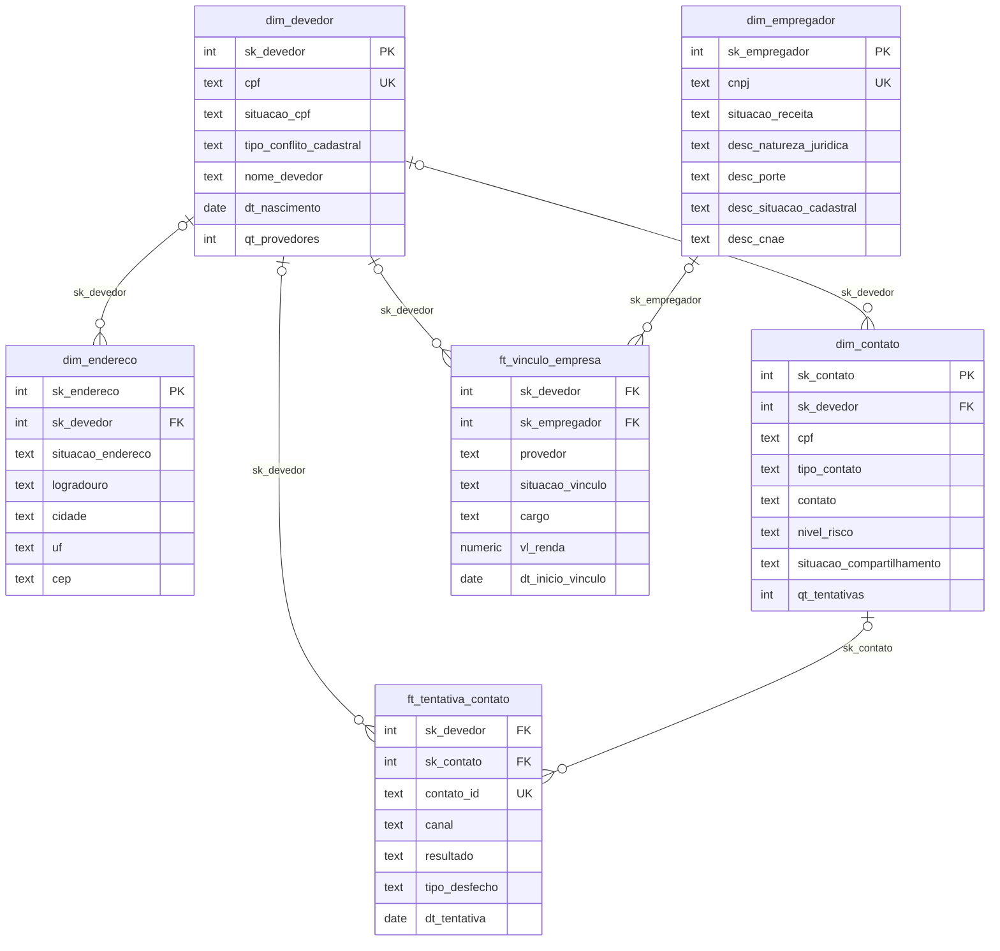
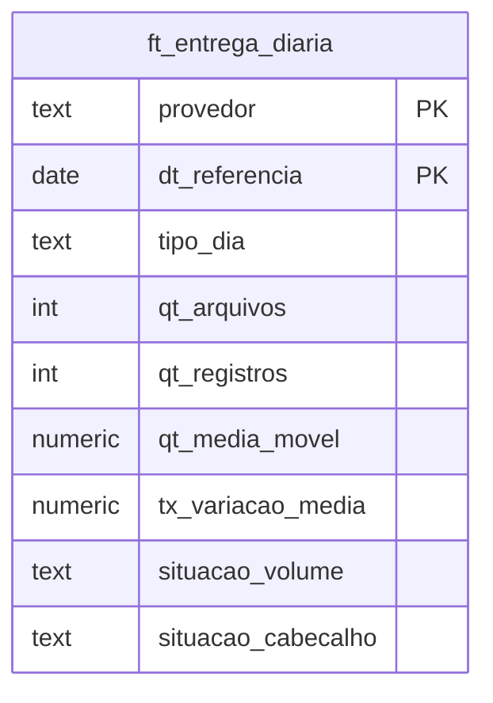
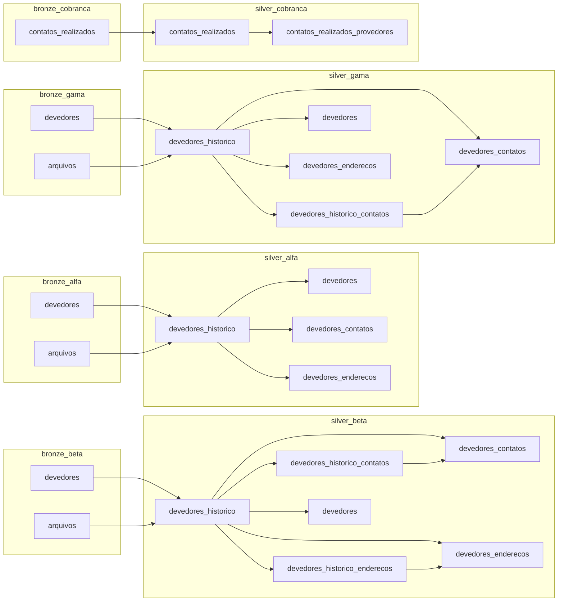
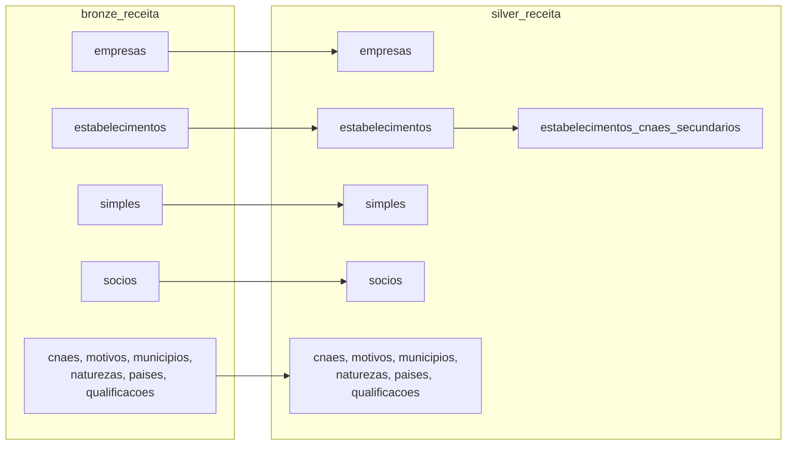
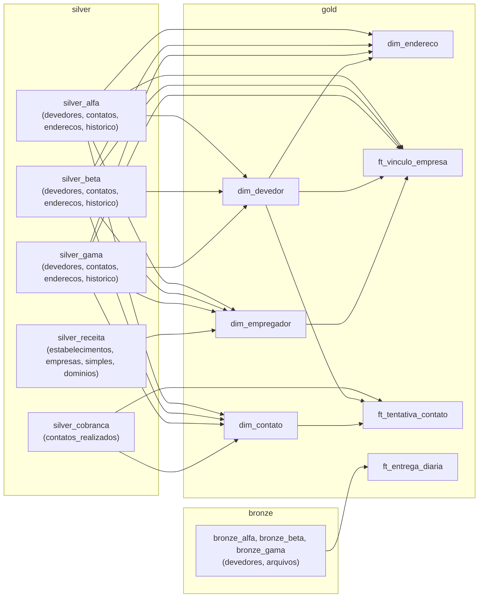

# ERD

**Como ver os diagramas:** no [GitHub](https://github.com/Sebastian6-6/collections-contact-risk/blob/main/docs/erd.md); no VS Code 1.121+, pela pré-visualização do Markdown, que desenha Mermaid nativamente; no Cursor e no Antigravity, com a extensão [Markdown Preview Mermaid Support](https://open-vsx.org/extension/bierner/markdown-mermaid), que não deve ser usada no VS Code 1.121+, porque conflita com o nativo.

Diagramas em Mermaid das três camadas do banco. As colunas mostradas são as chaves e alguns atributos; a lista completa está em `models/gold/*/_modelos.yml` e no dicionário de dados.

## Gold: estrela de devedores (`models/gold/devedores`)

`dim_devedor` é o centro: uma linha por CPF. As demais tabelas apontam para ela por `sk_devedor`. Onde o devedor não é encontrado a chave fica `NULL` (não há linha "desconhecido"), por isso a chave estrangeira é opcional (`|o` no desenho) em todas as ligações.

Grãos:

- `dim_devedor`: uma pessoa identificada por um CPF.
- `dim_endereco`: um devedor por endereço padronizado distinto.
- `dim_contato`: um contato normalizado por devedor e documento de origem (`cpf`, `documento_original`, `tipo_contato`, `contato`).
- `dim_empregador`: um CNPJ recebido, com os atributos da Receita por `LEFT JOIN`.
- `ft_vinculo_empresa`: um período contínuo do mesmo conteúdo de vínculo, por documento e provedor.
- `ft_tentativa_contato`: uma tentativa de contato recebida da Cobrança.

## Gold: monitoramento (`models/gold/monitoramento`)

Um fato isolado, sem dimensão: monitora a entrega dos arquivos de cada provedor, e a Cobrança não entra.

Grão: um provedor (`alfa`, `beta`, `gama`) por data de referência.

## Visão por camada

Cada fonte tem o seu schema nas três camadas: `bronze_<fonte>`, `silver_<fonte>` e `gold_devedores` e `gold_monitoramento`. A ingestão grava a bronze; a silver trabalha dentro de uma fonte; a gold une as fontes. Os modelos efêmeros (`*_padronizados`) e as etapas internas da gold não aparecem.

### Bronze para silver, por fonte

### Receita (dados abertos)

A Receita é uma fonte como as outras. As tabelas de domínio passam para a silver sem derivar de outra tabela.

### Silver para gold

