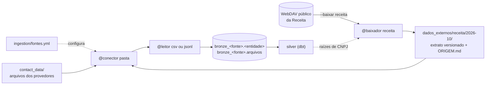

# Ingestão multi-fonte

A ingestão (`ingestion/`) lê os arquivos de cada fonte e grava a bronze no DuckDB, uma linha por linha recebida, sem transformar nada. Ela atende a convenção do case de que `ingestion/` faz a "leitura dos arquivos dos provedores, sem transformação" (AGENTS.md, convenções do case). Hoje recebe cinco fontes em três formatos e duas origens: os provedores `alfa` (CSV), `beta` (JSON Lines) e `gama` (CSV com JSON embutido), o histórico `cobranca` e a Receita Federal (`receita`), que chega por uma API e é gravada como arquivo antes de ser lida.

As decisões por trás do desenho (reler tudo, rastreabilidade, gravação em lote) estão em [decisoes-de-modelagem.md](decisoes-de-modelagem.md), seções 3, 4 e 9. O que cada fonte entrega está em [contratos-de-dados.md](contratos-de-dados.md).

## 1. Arquitetura

São quatro peças, cada uma com uma responsabilidade:

| Peça | Onde | O que faz |
|---|---|---|
| Configuração | `ingestion/fontes.yml` | tudo o que é específico de uma fonte: para cada entidade, a origem, o formato, a lista de locais (`caminho` e `padrao`) e, se precisar, `encoding`, `separador` e `colunas`; para uma fonte externa, o bloco `_baixar` |
| Conector | `ingestion/conectores.py`, `@conector("nome")` | diz de onde vêm os arquivos de uma entidade e devolve a lista em ordem fixa. Hoje existe só o `pasta`, que lista os arquivos que casam com o padrão, ordenados pelo caminho em texto (a comparação de `Path` ignora maiúsculas no Windows, e a ordem mudaria entre sistemas) |
| Leitor | `ingestion/leitores.py`, `@leitor("nome")` | diz como ler um formato e devolve uma linha por linha recebida, com o texto original. Hoje: `csv` (com cabeçalho ou, com `colunas`, sem cabeçalho) e `jsonl` |
| Baixador | `ingestion/conectores.py`, `@baixador("nome")` | traz de fora (uma API) o que a pipeline vai ler e grava numa pasta versionada. Só roda quando chamado, com `python -m ingestion.main --baixar <fonte>`; a pipeline nunca o chama. Hoje existe só o `receita` |

O `main.py` só junta as peças: lê a configuração, valida (origem e formato registrados, encoding conhecido, separador de um caractere, `colunas` só para leitor que as aceita), pede os arquivos ao conector, passa cada um ao leitor e grava. Os registros são dicionários preenchidos pelos decoradores, então uma peça nova não muda o `main.py`; um nome que não está registrado é erro, com a lista dos disponíveis.

**A bronze.** Cada entidade vira `bronze_<fonte>.<entidade>`. No CSV, as colunas são a união dos cabeçalhos de todos os arquivos da entidade, em texto; no JSON Lines, a coluna `registro` guarda o texto da linha. Toda tabela ganha cinco colunas de rastreabilidade, e nenhuma interpreta o dado:

| Coluna | Conteúdo |
|---|---|
| `_arquivo` | caminho relativo à raiz do repositório |
| `_linha` | linha física onde o registro começa (um campo entre aspas pode ter quebra de linha) |
| `_hash_arquivo` | sha256 do arquivo |
| `_linha_original` | o texto da linha como chegou |
| `_motivo_ilegivel` | preenchido só quando o leitor não consegue separar a linha em colunas |

Cada fonte ganha também o registro `bronze_<fonte>.arquivos`, com arquivo, entidade, hash, bytes, linhas e cabeçalho. A linha ilegível (CSV malformado ou em branco) entra com o texto e o motivo, e nenhuma linha é descartada. Um byte fora do encoding interrompe a fonte, com o arquivo e a linha no erro, porque não há como saber o que o byte significava. Cada fonte é gravada numa transação: ou entram todas as tabelas dela, ou nenhuma; o erro de uma fonte não impede as outras.

## 2. Por que reler tudo a cada execução

A cada execução, a ingestão lê todos os arquivos de todas as fontes e grava a bronze de novo. Não há modos de carga, estado guardado entre execuções nem cópia intermediária: `python pipeline.py` apaga o banco, roda a ingestão e o `dbt build`.

O enunciado pede que "a execução da pipeline a partir do estado inicial deve produzir exatamente os mesmos resultados a cada rodada" (p. 2). Com o banco recriado do zero, o resultado depende só dos arquivos, e reler tudo é o caminho mais curto até isso:
- **nada muda entre execuções:** a bronze não guarda horário de execução, data de modificação do arquivo nem id aleatório. A rastreabilidade vem do arquivo, da linha e do hash;
- **a ordem é fixa:** o conector ordena os arquivos pelo caminho em texto, e o leitor mantém a ordem das linhas;
- **um arquivo nunca entra duas vezes:** um arquivo que case com duas entradas da configuração é erro;
- **reenvio e arquivo atrasado não são caso especial:** entram como qualquer outro arquivo, e quem resolve a duplicação é a deduplicação por chave da silver.

Quem fiscaliza: o teste `test_duas_execucoes_geram_tabelas_identicas`, o teste `test_nenhuma_tabela_guarda_caminho_absoluto_nem_horario` e, no CI, `scripts/verificar_execucoes_identicas.py`, que roda a pipeline completa duas vezes e compara o resultado.

O custo é que o tempo cresce com o histórico. A comparação com a alternativa (pular o arquivo já carregado pelo caminho e pelo hash, como fazem Snowflake e Databricks) está em [decisoes-de-modelagem.md](decisoes-de-modelagem.md), seção 3.

## 3. Como trazer uma fonte nova

Cada provedor ou sistema que produz dados é uma fonte. O caminho depende do que já existe:

1. **Formato e origem já existem:** uma entrada em `ingestion/fontes.yml`. Exemplo: uma tabela nova de um provedor em CSV numa pasta é só uma entidade nova, com `origem: pasta`, `formato: csv` e a lista de `arquivos`. Um CSV sem cabeçalho, com outro separador ou outro encoding também cabe aqui, por configuração (`colunas`, `separador`, `encoding`), como nas tabelas da Receita.
2. **Formato novo:** uma função em `ingestion/leitores.py` com `@leitor("nome")`, que recebe o caminho, o encoding e o separador (e, se aceitar, `colunas`) e devolve uma `Leitura`, com uma `LinhaLida` por linha recebida. Na configuração, `formato: nome`.
3. **Origem nova (bucket, outro sistema de arquivos):** uma função em `ingestion/conectores.py` com `@conector("nome")`, que recebe um `Local` e a raiz do repositório e devolve os arquivos a ler, em ordem fixa. Na configuração, `origem: nome`.
4. **API:** a resposta da API é gravada como arquivo numa pasta versionada antes de ser lida. Quem grava é um baixador, uma função em `ingestion/conectores.py` com `@baixador("nome")`, que recebe o bloco `_baixar` da fonte, a raiz do repositório e o banco da pipeline e devolve os arquivos gravados. Na configuração, a fonte ganha o bloco `_baixar` (`origem`, `destino`, `parametros`), e as entidades leem a pasta `destino` com o conector `pasta`. A partir daí valem o mesmo leitor e a mesma rastreabilidade.

Nos quatro casos, a tabela é declarada em `models/bronze/<fonte>/_fontes.yml`, com descrição e testes, e o `main.py` não muda.

## 4. A Receita como exemplo de API

O enunciado pede para "cruzar as informações de empregador com os dados abertos do CNPJ da Receita Federal" (p. 1) e demonstrar "o que a base de CNPJ agrega à esteira de cobrança" (p. 2). A Receita publica por mês 37 zips, com 7.808.752.942 bytes (7,8 GB) e 223.636.289 registros em 2026-10, contados pelo baixador. O projeto precisa só das empresas recebidas dos provedores (13 raízes de CNPJ).

**Acesso por WebDAV.** O download oficial fica num compartilhamento público do Nextcloud da Receita. O cliente `ingestion/webdav.py` usa o WebDAV público desse compartilhamento: `PROPFIND` para listar a pasta do mês (tamanho e data de cada arquivo) e `GET` com retomada (`Range`) para baixar; o usuário é o token do compartilhamento, e a senha é vazia. É o mecanismo padrão do Nextcloud, e não uma API documentada pela Receita. Usa só a biblioteca padrão do Python.

**Mês fixado.** O mês (`2026-10`) e a pasta de destino estão em `ingestion/fontes.yml`, no bloco `_baixar` da fonte `receita`. O baixador nunca procura "o mais recente": mesma origem e mesmo mês dão os mesmos arquivos. Para outro mês, troca-se `mes` e `destino` e baixa-se de novo.

**sha256 calculado.** A Receita não publica checksum: na pasta do mês só há os zips, e o `ETag` do WebDAV é um identificador de versão do Nextcloud, não o hash do conteúdo (o do `Motivos.zip` não bate com o MD5 do arquivo). Por isso o baixador confere o tamanho de cada zip contra o anunciado na listagem, lê o zip (o que confere o CRC-32 de cada membro) e calcula o sha256 de cada um.

**Extrato versionado.** O baixador grava em `dados_externos/receita/2026-10/`:
- as 6 tabelas de domínio inteiras (`cnaes`, `motivos`, `municipios`, `naturezas`, `paises`, `qualificacoes`);
- de `empresas`, `estabelecimentos`, `simples` e `socios`, só os registros cuja raiz de CNPJ (8 primeiros caracteres) foi recebida, byte a byte como a Receita publicou;
- o `ORIGEM.md`, com a URL, o mês, a licença, os bytes, a data no servidor, o sha256 e os registros de cada zip baixado, o que o extrato tem e a lista de raízes com o sha256 dela. O texto não tem horário nem caminho da máquina.

O extrato tem 40.190 registros em 7.815.171 bytes, cerca de mil vezes menos que os zips. Os zips ficam num cache local fora do git (`.cache/receita`); um zip que já está no cache com o tamanho anunciado não é baixado de novo. Se um zip falha, a pasta de destino fica como estava. Como as raízes saem da silver, a ordem é: rodar a pipeline, rodar `python -m ingestion.main --baixar receita` e rodar a pipeline de novo.

**CI offline.** A pipeline e o CI leem só a pasta versionada, com o conector `pasta` e o leitor `csv` (`colunas` do layout oficial, `separador: ";"`, `encoding: latin-1`), como qualquer outra fonte. Nenhum passo do CI chama `--baixar` nem depende da rede ou da disponibilidade do servidor da Receita. Os testes do baixador (`tests/ingestion/test_receita.py`, `test_webdav.py`) usam um servidor WebDAV falso (`tests/ingestion/servidor_webdav.py`), sem rede. Se a Receita republicar o mesmo mês com outro conteúdo, baixar de novo muda o sha256 no `ORIGEM.md`, e a mudança aparece no diff.
