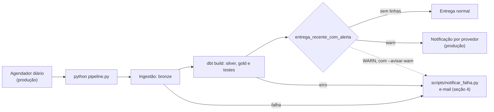

# Monitoramento das entregas diárias

O enunciado pede investigar se houve problema de ingestão em algum dia, uma estratégia de normalização e, se aplicável, a arquitetura de um monitoramento diário automatizado, que pode usar uma média móvel (p. 1–2), "sem complexidade desnecessária" (p. 4).

Os números saem de `gold_monitoramento.ft_entrega_diaria`: uma linha por provedor e dia com entrega, 87 entregas de 01 a 30/09/2026, sem a carga histórica. Os alertas saem de `dbt show --select alertas_das_entregas` (`analyses/alertas_das_entregas.sql`), depois de `python pipeline.py`.

## 1. O que aconteceu e como a pipeline trata

| Dia | O que aconteceu | Como a pipeline trata | Alerta |
|---|---|---|---|
| alfa, 12/09 | O cabeçalho troca `cpf` por `documento`, e os 18 arquivos a partir desse dia vêm assim. | A bronze guarda a união dos cabeçalhos, e a silver junta as duas colunas em `documento` (`COALESCE`). Uma coluna nova que não está declarada reprova a pipeline (`colunas_declaradas`). | `cabecalho_mudou` |
| gama, 15/09 | O original tem 85 linhas, e a última está cortada. O reenvio (`_reenvio`, mesma data) traz 311. | A linha cortada entra na bronze com o motivo e não vai para a silver. Na ordem das versões, o `_arquivo` desempata e o reenvio vence: as 200 versões vencedoras de 15/09 vêm dele ([decisoes-de-modelagem.md](decisoes-de-modelagem.md), 5.3). | `reenvio` (2 arquivos), `linhas_ilegiveis` (1), `registros_repetidos` (108 de 396, 27%) |
| alfa, 22/09 | Não chega arquivo. | Não há o que refazer: os registros do dia vêm no arquivo seguinte. | `dia_sem_entrega` em 23/09 |
| alfa, 23/09 | 715 linhas contra uma média de 352,2 (+103%). 362 linhas (51%) foram atualizadas antes do dia da entrega: são os registros do dia 22. | A versão atual é ordenada pela data de atualização antes da data de entrega, então um registro atrasado ocupa o lugar certo e não passa na frente de um mais novo (5.3). | `volume_acima`, `registros_atrasados` |
| beta, 24 e 25/09 | Não chega arquivo, e esses registros não aparecem em nenhum outro ([contratos-de-dados.md](contratos-de-dados.md), seção 3). | Nada a normalizar: os modelos não geram linhas que não existem na origem (convenção do case). Os devedores afetados ficam com a versão anterior até o provedor reenviar. | `dia_sem_entrega` (2 dias) em 26/09, a entrega seguinte |
| beta, 29/09 | 761 linhas contra 349,8 (+118%). 353 linhas (46%) repetem, com o texto idêntico, registros que já tinham chegado: o dia 28 reenviado. | O conteúdo igual vira uma versão só (`hash_conteudo`, seção 6.3), então o reenvio não cria devedor nem versão. | `volume_acima`, `registros_repetidos`, `registros_atrasados` |

São 11 alertas em 5 entregas, e os 6 incidentes conhecidos aparecem. Nenhuma outra entrega gera alerta.

**Data padrão 2025-09-01.** Não é problema de um dia: são cerca de 370 linhas da bronze por provedor (376 no alfa, 372 no beta e 372 na gama; em versões da silver são 372, 365 e 367, em [perfil-das-fontes.md](perfil-das-fontes.md)) com essa data de atualização, só nos arquivos históricos, e nenhum nas entregas diárias. A data fica como veio na ordenação da versão atual (decisão de 2026-11-09). Tratá-la como ausente mudaria a versão atual de no máximo 5 devedores por fonte ([decisoes-de-modelagem.md](decisoes-de-modelagem.md), 5.4). Como o histórico fica fora do monitoramento, quem vigia é o par de testes `beta_data_20250901_so_no_historico` e `gama_data_20250901_so_no_historico`, que avisam se a data aparecer numa entrega diária. O alfa não tem esse teste.

## 2. Como o alerta pega

Cada entrega é comparada com o próprio provedor:

- **Volume:** a média das 5 entregas anteriores do mesmo tipo de dia (útil ou fim de semana) e um limite de ±50%. Com menos de 3 entregas na base, a situação é `sem_base`: são 18 entregas, as 3 primeiras de cada tipo de dia em cada provedor. Feriado conta como o dia da semana em que cai.
- **Dia sem entrega:** a entrega *n* contra a *n − 1*, por `ROW_NUMBER()`. Mais de um dia de calendário entre as duas é um dia perdido.
- **Reenvio e cabeçalho:** mais de um arquivo no dia, ou um cabeçalho diferente do da entrega anterior. A checagem de cabeçalho não vale para o beta, que chega em JSON Lines e não tem cabeçalho.
- **Linhas repetidas ou atrasadas:** acima de 25% da entrega. Toda entrega traz algumas (no alfa de 28/09, 35 de 441, 8%), por isso o limite não é zero.
- **Linhas ilegíveis:** qualquer uma.

As regras ficam num lugar só, a macro `alertas_da_entrega`, e os limites ficam em `dbt_project.yml`. O teste `entrega_recente_com_alerta` aplica as regras à entrega mais recente de cada provedor, com severidade `warn`: o alerta pede que alguém olhe o provedor, mas não para a pipeline. Na execução sobre os dados do case, a entrega mais recente é a de 30/09, e o teste passa sem nenhuma linha.

**Por que a média por tipo de dia.** O fim de semana tem menos da metade do volume de um dia útil (no alfa, 165 em 12/09 contra cerca de 400). Com a média simples das 7 entregas anteriores, o mesmo ±50% dá 13 alarmes falsos, todos em fim de semana. Com a média por tipo de dia, são 0, e os dois picos continuam aparecendo (medido no commit 325264b). A menor margem é o alfa de 26/09: 192 linhas contra 130,4, +47%.

**Limites.** Os dados são sintéticos, e o histórico é de um mês. A janela, o limite e o 0 de alarmes falsos foram medidos nos mesmos dados usados para calibrar. O 0 descreve setembro, não garante o comportamento em outro mês. Um dia perdido só aparece quando chega a entrega seguinte: o beta ficou dois dias sem arquivo e o alerta veio no terceiro. Somar o original ao reenvio também esconde a queda de volume da gama em 15/09: o original sozinho, com 85 linhas contra 366,6, daria −77% (conta feita aqui, não executada pela pipeline). O alerta do dia vem do reenvio e da linha ilegível.

## 3. Arquitetura diária



**O que já roda:**

- `python pipeline.py` recria o banco, lê todos os arquivos, grava a bronze e roda `dbt build`. A `ft_entrega_diaria` e o teste de alerta fazem parte do build. Um `warn` não muda o código de saída, só um erro.
- `dbt show --select alertas_das_entregas` lista todos os alertas do histórico, não só os do dia.
- O CI roda a pipeline duas vezes em cada push e pull request para a `develop` e a `main`, e o resultado precisa ser idêntico.

**O que fica para produção:**

- **Agendamento:** rodar a pipeline uma vez por dia, depois do horário combinado de entrega dos provedores.
- **Notificação por provedor:** ler o status do teste `entrega_recente_com_alerta` em `target/run_results.json`, o arquivo de resultados que o dbt grava a cada execução, e mandar as linhas do alerta ao responsável pelo provedor. O e-mail da seção 4 só avisa que a pipeline falhou ou teve WARN, sem as linhas do alerta.
- **Dia perdido no próprio dia:** comparar os provedores esperados com os arquivos que chegaram, para avisar a falta no mesmo dia, e não só quando chegar a entrega seguinte.
- **Carga incremental:** quando reler tudo ficar caro, pular o arquivo já carregado pelo caminho e pelo hash ([decisoes-de-modelagem.md](decisoes-de-modelagem.md), seção 3). Hoje a pipeline completa leva cerca de 30,7 s (mediana de 3 execuções em 2026-11-10).
- **Recalibração:** revisar a janela e o limite com alguns meses de histórico, contando os alarmes falsos fora da amostra de calibração.

## 4. Alerta por e-mail

`scripts/notificar_falha.py` manda um e-mail curto, com o motivo e as últimas 20 linhas de `logs/dbt.log`, quando a ingestão falha ou o `dbt build` termina com erro. Só usa a biblioteca padrão (`smtplib`), e o código de saída da pipeline não muda.

A configuração vem só de variáveis de ambiente; nada é gravado em arquivo. Sem elas, o script imprime que o alerta está desligado e não faz nada, então um clone limpo e o CI seguem iguais.

| Variável | Exemplo |
|---|---|
| `ALERTA_SMTP_HOST` | `smtp.exemplo.com` |
| `ALERTA_SMTP_PORTA` | `587` (usa STARTTLS) |
| `ALERTA_SMTP_USUARIO` | `usuario` |
| `ALERTA_SMTP_SENHA` | a senha ou senha de aplicativo |
| `ALERTA_EMAIL_DE` | `pipeline@exemplo.com` |
| `ALERTA_EMAIL_PARA` | `responsavel@exemplo.com` |

```bash
export ALERTA_SMTP_HOST=smtp.exemplo.com ALERTA_SMTP_PORTA=587 ALERTA_SMTP_USUARIO=usuario
export ALERTA_SMTP_SENHA=... ALERTA_EMAIL_DE=pipeline@exemplo.com ALERTA_EMAIL_PARA=responsavel@exemplo.com
python pipeline.py                 # avisa só na falha
python pipeline.py --avisar-warn   # avisa também quando o dbt build termina com WARN
```

O aviso de WARN é opcional e vem desligado, porque os 9 WARN de hoje são esperados. Os testes usam um servidor SMTP falso; o envio real não foi testado, porque depende de credenciais do dono.
